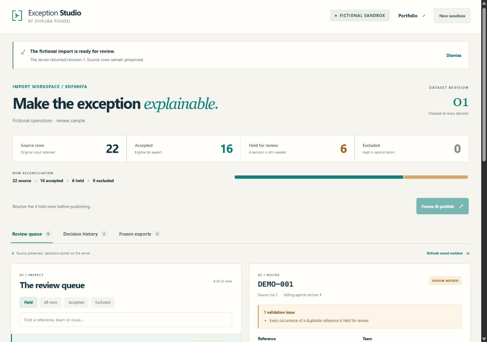

# Exception Studio

**An operations import should explain what changed before it becomes a report.**

Exception Studio is a full-stack workbench for reviewing an imperfect operational dataset. It preserves the source, holds exceptions for a reasoned decision, reconciles every row, and freezes accepted records into an inspectable CSV and manifest.

Created and maintained by **Dhruba Poudel**. React · TypeScript · Node.js · SQLite.

**Public demo: deployment verification pending.** The intended address is [studio.dhrub.com.np](https://studio.dhrub.com.np/). Until deployment is verified, use the local instructions below.



## The problem

A dashboard can look convincing while its input contains duplicate references, missing ownership, impossible dates or negative effort. Silently dropping those rows hides uncertainty; editing the source removes context.

This project makes that boundary visible. Its fictional 22-row service-data sample begins with **16 accepted records and 6 held records**. Every source row remains accounted for:

```text
source rows = accepted + held + excluded
```

The application demonstrates the review and publication step before downstream reporting. It does not claim a production business rollout, customer outcome or verified approval identity.

## Try the workflow

1. Load the mixed fictional sample and inspect the held rows.
2. Compare immutable source values with editable current values.
3. Correct a row or exclude it with a specific reason. Every successful decision revalidates the active batch.
4. Review the decision history and reconciliation totals.
5. When no held rows remain, freeze the revision and download its CSV and JSON manifest.
6. Make a later correction: the earlier download keeps its exact bytes and hash.

An important edge case is deliberate: correcting one duplicate can clear another row's validation issue, but that original exception still requires explicit human review. A green rule result does not silently become an approval.

For a reproducible walkthrough, including stale edits and unchanged earlier exports, see [DEMO.md](docs/DEMO.md).

## Technical substance

| Concern | Implemented behaviour |
| --- | --- |
| Server state | Real same-origin Node API backed by SQLite; the client does not substitute mock records when the API fails |
| Source preservation | Original CSV, source hash and original row values are retained separately from corrections; SQL triggers reject updates to source content |
| Atomic decisions | Row correction, whole-batch validation, revision, decision event and retry record commit together or roll back together |
| Concurrent edits | Commands carry an expected dataset revision; a stale command returns `409` and requires deliberate recovery |
| Uncertain requests | Import, decision and publication use idempotency keys; the client retries an uncertain command with the original key and body |
| Session uncertainty | If starting a fresh sandbox has an unreadable response, changes are paused until the browser's current session is reloaded |
| Reproducible exports | Publication stores frozen CSV bytes and a manifest with counts, source SHA-256 and exported-data SHA-256 |
| Spreadsheet handling | Formula-leading exported cells are neutralised; quoted CSV parsing and source line references are tested |
| Demo isolation | An opaque cookie selects one bounded anonymous sandbox; records and publications from another sandbox return `404` |

These are bounded application guarantees. They are not enterprise authentication, independent audit certification or a claim that the software is infallible. [SECURITY.md](SECURITY.md) describes the trust boundaries.

## Run locally

Use **Node.js 24** and **pnpm 11.25.0**. The server uses Node's built-in `node:sqlite`; no database service, account or external API key is needed.

```sh
pnpm install --frozen-lockfile
pnpm test
pnpm build
pnpm start
```

Open **http://127.0.0.1:8080**. The default server binds only to the local machine. The SQLite database is created at `data/exception-studio.sqlite`, relative to the working directory.

For an explicit local configuration in PowerShell:

```powershell
$env:HOST = '127.0.0.1'
$env:PORT = '8080'
$env:PUBLIC_ORIGIN = 'http://127.0.0.1:8080'
$env:DATABASE_PATH = 'data/exception-studio.sqlite'
pnpm start
```

Use that exact URL when `PUBLIC_ORIGIN` is set; `localhost` and `127.0.0.1` are different origins.

For client development, the Vite proxy expects the API on port `65457`. In one PowerShell terminal:

```powershell
pnpm build:server
$env:HOST = '127.0.0.1'
$env:PORT = '65457'
$env:PUBLIC_ORIGIN = 'http://127.0.0.1:65458'
pnpm start
```

In another terminal run `pnpm dev`, then open **http://127.0.0.1:65458**. The configured public origin is the browser-facing Vite address; `/api` requests are proxied to the local Node server.

### Configuration

| Variable | Default | Purpose |
| --- | --- | --- |
| `HOST` | `127.0.0.1` | Server bind address; hosting may require `0.0.0.0` |
| `PORT` | `8080` | HTTP listening port |
| `PUBLIC_ORIGIN` | unset | Exact allowed browser origin; set the external HTTPS origin on a hosted deployment |
| `DATABASE_PATH` | `data/exception-studio.sqlite` | Writable SQLite file, outside the static client directory |
| `DEMO_ONLY` | `true` | Scope label; both settings accept bundled fictional fixtures only |

There is **no custom upload endpoint**. The mixed and clean fixtures are the only import sources in both modes. Review reasons are sent to the server and stored with the session: use fictional notes and no personal, employer or client information.

## Verification

As checked on **27 October 2026**, the automated suite contains **35 backend/domain/HTTP checks and 13 UI checks**. Run `pnpm test` to reproduce them against your checkout.

The tests cover failure paths as well as the main workflow: invalid-correction rollback, simultaneous writes, exact retry replay, source immutability, isolation, size/capacity/expiry boundaries, formula-safe CSV, frozen downloads after edits and database restart, stale-form recovery, and an uncertain session-switch response. UI checks run in a simulated DOM; they do not replace browser, accessibility or hosting checks.

```sh
pnpm test:api
pnpm test:ui
pnpm typecheck
pnpm build
```

## Read the implementation

```text
src/client/             React interface, request recovery and view models
src/shared/contracts.ts API commands, snapshots and manifests
src/server/domain.ts    CSV parsing, validation, reconciliation and hashing
src/server/store.ts     SQLite schema, transactions and publication snapshots
src/server/app.ts       HTTP routes, cookies, origin checks and static serving
src/server/index.ts     Runtime configuration and expiry cleanup
tests/                  Domain, store and real HTTP tests
docs/                   Architecture, decisions and demonstration guide
```

- [Architecture and API](docs/ARCHITECTURE.md)
- [Engineering decisions and trade-offs](docs/DECISIONS.md)
- [Demonstration guide](docs/DEMO.md)
- [Security scope and reporting](SECURITY.md)

## Scope and retention

Anonymous sandboxes expire **24 hours after creation**. Expired access is rejected immediately; cleanup runs when a new sandbox is created and approximately every ten minutes while the server runs. Download files you want to keep. Public demo data may also reset on redeployment or hosting storage replacement.

Application cleanup is not a secure-erasure guarantee. Database files, SQLite journals, hosting copies and backups remain within the operator's trust boundary. The demo has no sign-up, verified reviewer identity, multi-organisation tenancy or production service guarantee.

## Licence

[MIT](LICENSE) · Copyright © 2026 Dhruba Poudel.
