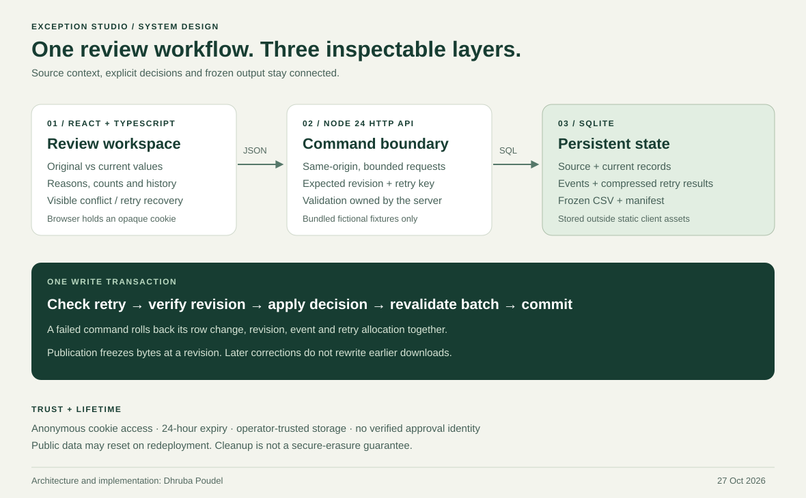

# Architecture

Author: **Dhruba Poudel** · Documentation checked: **27 October 2026**

Exception Studio keeps one coherent workflow across the interface, API and database: preserve a fictional source, resolve its exceptions, then freeze a reviewed revision. React renders server snapshots; the Node application owns validation and state transitions.



## Runtime and boundaries

The built React client and JSON API share an origin. The Node HTTP server serves only `dist/client`, with database storage outside that directory. The backend uses `node:sqlite` on Node 24. There is no external identity provider, third-party API or separate database service.

The browser holds an opaque session cookie. Only its SHA-256 hash is stored in SQLite. A sandbox ID shown in a snapshot is not its access token. The cookie selects an anonymous workspace; it does not establish a person's identity. A copied valid cookie grants access to that sandbox until expiry.

The public interface imports one of two bundled fictional CSV fixtures. No upload control or custom-data API exists. Editable review reasons are still user input and are persisted, so the UI asks visitors to use fictional notes.

## Data model

| Table | Responsibility |
| --- | --- |
| `sandboxes` | Token hash, creation/expiry timestamps, active import and dataset revision |
| `imports` | Original CSV bytes represented as text, fixture metadata, source SHA-256 and source row count |
| `source_rows` | Original values, current values, decision, explicit-review state and latest reason |
| `events` | Ordered application history, revision, before/after changes and reason |
| `publications` | Frozen accepted CSV bytes and manifest JSON, unique per import/revision |
| `idempotency` | Sandbox/route/key scope, canonical request hash and compressed original response |

Foreign keys cascade sandbox cleanup. SQL triggers reject updates to original import content, original row identity/values and published snapshots. These protect normal application operations and accidental updates; a database owner can change the schema or file.

SQLite uses foreign keys, WAL journalling and a five-second busy timeout. Synchronous bounded transactions simplify a single-process demonstration. This is not a design for horizontally scaled writers against an ephemeral local file.

## Record contract and reconciliation

Every source record has six string fields in a fixed order:

```text
reference,team,opened,due,status,minutes
```

Rules check required values, field lengths, reference format, case-insensitive duplicates, real calendar dates, chronological order, allowed status and whole-number effort. The status enum is `open | in_progress | resolved`; minutes range from `0` to `100000` inclusive. Excluded rows remain visible and counted but do not participate in duplicate matching.

An imported clean row starts accepted. An imported exception starts unreviewed and remains held until an explicit valid acceptance or exclusion. Whole-batch validation runs after each decision: a previously accepted row that becomes invalid is held. Current validation and explicit-review state are separate concepts.

At every snapshot:

```text
total = accepted + held + excluded
```

Only valid accepted records contribute to accepted minutes or the exported CSV. `changed` counts rows whose current values differ from source; it is not a fourth reconciliation category.

## Mutation transaction

An import, decision or publication enters a `BEGIN IMMEDIATE` transaction. The store:

1. Resolves a valid, unexpired sandbox.
2. Checks the route-scoped idempotency key and canonical request fingerprint.
3. For a new decision/publication, compares `expectedRevision` with current revision.
4. Applies the bounded command and validates the resulting batch.
5. Writes the result, event and original response for retries.
6. Commits all effects together, or rolls everything back on failure.

An invalid acceptance returns `422` without consuming the retry key or changing rows, events or revision. A stale expected revision returns `409`, including `currentRevision`. Actual concurrent HTTP tests submit two decisions against one revision: exactly one commits.

An import or successful row decision increments the dataset revision. Publishing records that revision without incrementing it. Repeating publication of the same active import/revision returns the existing publication.

## Request recovery

For import, decision and publication, the client creates one request body and one idempotency key before sending. If a response is lost or unreadable, it keeps that command, pauses other mutations and offers **Retry the same request**. A matching retry returns the exact stored response and reports `Idempotency-Replayed: true`. Reusing the key with changed content returns `409`.

The replay may represent an older revision if another action happened later. It confirms the original command's result rather than silently pretending to be a new workspace read. An explicit refresh obtains the current saved revision.

Fresh sandbox creation rotates a cookie and is not one of the idempotent commands. If that response cannot be read, the browser might already have switched sessions. The client marks displayed data stale, blocks changes and requires **Reload session** before continuing. It does not automatically create another sandbox to resolve uncertainty.

## Publication boundary

Publication requires at least one accepted record and zero held records. The server stores spreadsheet-neutralised CSV bytes and manifest JSON together. The manifest includes source SHA-256, exported-data SHA-256, byte length, revision, reconciliation counts, columns, publication/import identifiers, timestamp and author/creator `Dhruba Poudel`.

Hashes identify bytes; they do not independently certify correctness or reviewer identity. A later decision, later import or process restart does not regenerate an older publication. It is read from its frozen database record. Session expiry or deployment storage replacement can still remove it.

## API surface

All JSON responses use shared TypeScript contracts in [`src/shared/contracts.ts`](../src/shared/contracts.ts). Errors use `{ "error": { "code", "message", "currentRevision"?, "issues"? } }`.

| Method and route | Request | Result |
| --- | --- | --- |
| `GET /api/session` | Session cookie when present | Resume workspace, or create one if no valid cookie |
| `POST /api/session` | Empty JSON object `{}` | New workspace and cookie; previous workspace expires normally |
| `GET /api/workspace` | Existing session | Current saved snapshot |
| `POST /api/imports` | `{fixtureId: "mixed" \| "clean"}` + idempotency key | Import fixture and return snapshot |
| `PATCH /api/rows/:id/decision` | Expected revision, action, reason, optional field changes + key | Validated decision and snapshot |
| `POST /api/publications` | Expected revision + key | Frozen publication and snapshot |
| `GET /api/publications/:id.csv` | Owning session | Exact CSV attachment |
| `GET /api/publications/:id.json` | Owning session | Exact manifest attachment |
| `GET /api/health` | None | Application/mode/storage status, with no database path |

Mutation bodies are JSON, maximum 64 KiB, and require an allowed browser `Origin`. There is no permissive CORS route. A decision can either accept with corrections or exclude with a reason; exclusion cannot also alter field values.

## Bounds and operational limits

| Bound | Value |
| --- | --- |
| Sandbox lifetime | 24 hours from creation; not sliding |
| Simultaneous active sandboxes | 200 |
| Source rows per import | 200 maximum; bundled fixtures contain 22 |
| Imports / publications per sandbox | 20 / 20 |
| Stored idempotency commands per sandbox | 200 |
| Application events per sandbox | 400 maximum |
| Review reason | API: 1–280 characters; UI asks for at least 10 |
| New sandbox requests | 6/minute per network peer by default |
| Mutations | 90/minute per token, or network peer without a token |

Rate counters live in the process and reset on restart. Behind a reverse proxy, several visitors may share a network peer and creation quota. These bounds control a small demo; they do not establish a production abuse-prevention or availability guarantee.

Expiry is checked on access. Cleanup runs during new-session creation and every ten minutes while the entrypoint runs. The SQLite file persists across a normal process restart when the same path survives. Hosting redeployments may replace storage, and application deletion does not guarantee secure erasure from journals or backups.
