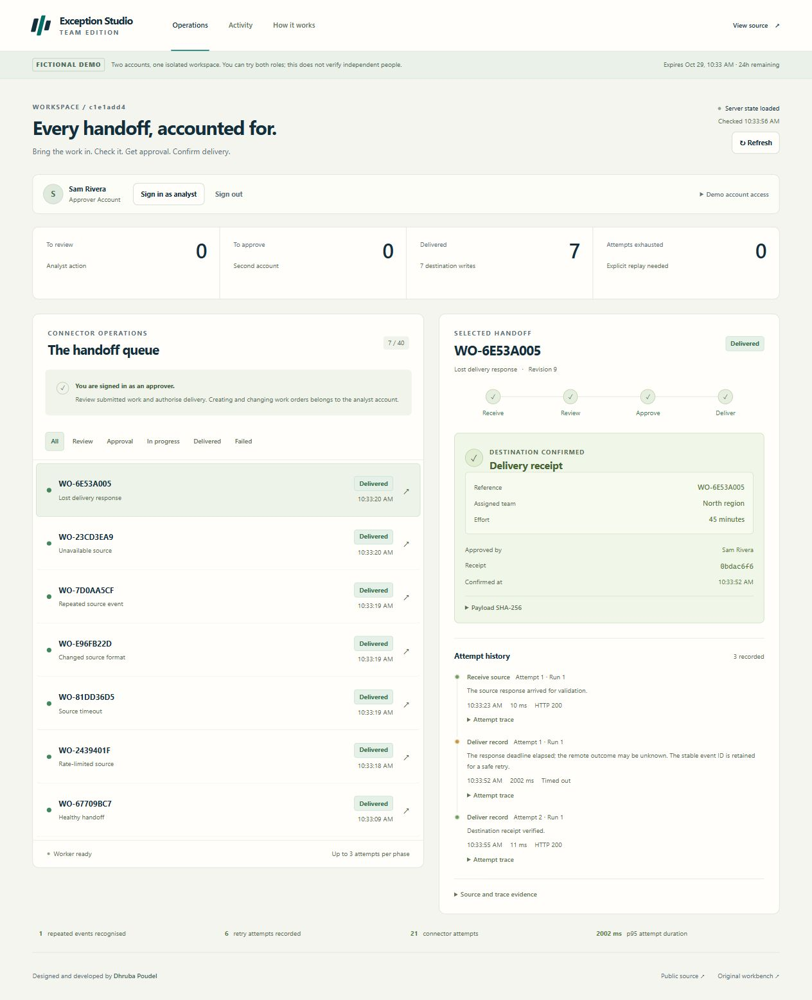

# Live Team Edition verification

Prepared by **Dhruba Poudel** · **28 October 2026**, Australia/Sydney

The HTTPS workflow at [studio.dhrub.com.np](https://studio.dhrub.com.np/) was exercised through its interface using a single fictional workspace. An analyst received and reviewed the records; a separate fictional approver authorised their delivery. Both accounts were controlled by the same visitor, so this does not establish independently verified human approval.

Runtime source: [`4d942cb`](https://github.com/dhrubasuz/exception-studio/commit/4d942cb767a7982a5658139536ebf478b8b9bc46). [Its hosted CI run passed](https://github.com/dhrubasuz/exception-studio/actions/runs/40602676648), including **110 tests**, formatting, production build and dependency checks.

## Observed recovery results

| Scenario | Live observation | Downloaded evidence |
| --- | --- | --- |
| Healthy | One source attempt, explicit analyst review, separate approval and one delivery receipt | [Trace](evidence/healthy-handoff.json) |
| Rate limit | Source returned `429`, `429`, then `200`; the job retained its identity and delivered | [Trace](evidence/rate-limited-source.json) |
| Source timeout | The first source attempt exceeded the 2,000 ms hosted deadline; its next attempt succeeded | [Trace](evidence/source-timeout.json) |
| Schema drift | Analyst mapped `workOrder` → `reference` and `region` → `team`, retaining the original source and 45-minute value | [Trace](evidence/changed-source-format.json) |
| Duplicate event | Running the repeated-event scenario twice produced one job and one receipt; the duplicate counter increased once | [Trace](evidence/repeated-source-event.json) |
| Upstream outage | Three `503` attempts reached dead letter; explicit restoration/replay started generation 2 and delivered | [Trace](evidence/unavailable-source.json) |
| Lost delivery response | Destination committed before a **2,002 ms timeout**; an **11 ms retry** confirmed the existing receipt | [Trace](evidence/lost-delivery-response.json) |

Final workspace totals were **7 delivered jobs, 7 destination writes, 1 recognised duplicate, 21 connector attempts and 6 retry attempts**. Source SHA-256 values and receipt payload SHA-256 values were independently recomputed from all seven downloaded traces and matched. Each job had distinct submitting/approving actor IDs and one destination commit event. The JSON copies here have been formatted for readability.

The recorded p95 attempt duration was **2,002 ms**, including deliberately induced failures. These are a small set of fictional demonstration observations, not throughput benchmarks, customer outcomes or business savings.

## Browser and deployment checks

- Verified desktop and **390 px mobile** layouts without horizontal overflow.
- Opened the same workspace in another tab; its current account and delivered jobs resumed from the server.
- Expanded Activity from 12 to 24 of 75 events, proving older evidence remains accessible.
- Downloaded all seven scoped traces through the authenticated interface.
- The public runtime-database URL returned `NOT_FOUND`.
- `/classic` still loaded its fictional import: **22 source rows, 16 accepted, 6 held**.
- Separate local checks verified IPv6-only TCP startup and managed-process shutdown messages.

## Scope

The connectors, accounts, source records and failures are fictional. Hosted connector calls use the app's exact configured HTTPS origin and fixed routes, with private database-backed authentication. They do not call real business systems or accept visitor-supplied target URLs.

Processing runs while the hosted web process is active. Workspaces expire after 24 hours, and deployment/storage changes can reset demo data. There is no always-on, production-readiness or complete-security guarantee. See [architecture](TEAM_ARCHITECTURE.md) and [security scope](../SECURITY.md).
